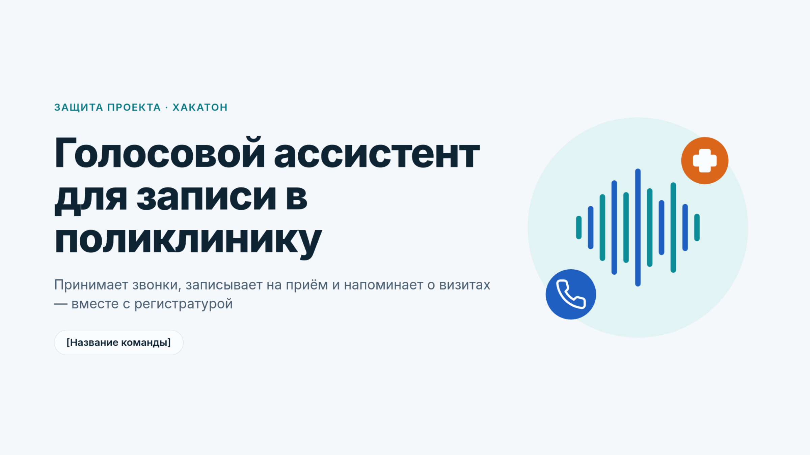
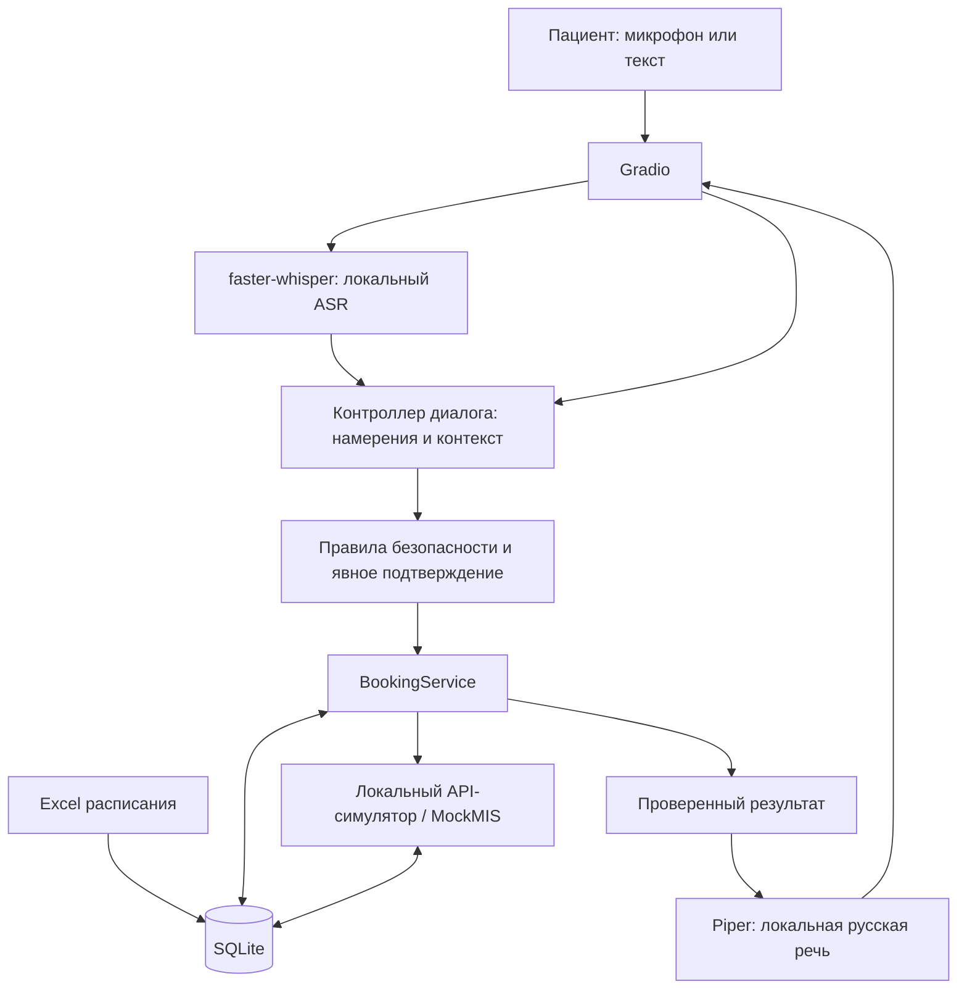

# Clinic Voice AI Assistant

Голосовой ИИ-помощник регистратуры поликлиники — локальный MVP для хакатона.

## Презентация проекта

**[Смотреть презентацию (PDF)](docs/presentation/clinic-voice-ai-pitch.pdf)** · 9 слайдов · [Скачать PDF](docs/presentation/clinic-voice-ai-pitch.pdf?raw=1)

> Презентация описывает концепцию и целевые показатели. Текущий MVP работает в локальном DEMO: настоящая МИС, телефония и напоминания не подключены; экономический эффект не измерен.

Исходный PowerPoint не предоставлен: опубликован оригинальный PDF, слайды не изменялись.

Пациент может своими словами попросить записать его к врачу, узнать время приёма, перенести или отменить запись. Ассистент распознаёт русскую речь, проверяет расписание, уточняет необходимые данные и озвучивает ответ. Критические действия требуют явного подтверждения.
Статус на 15.10.2026: работающий локальный DEMO/MOCK. Расписание импортируется из предоставленного организаторами Excel; данные кейса синтетические. Операции выполняются в локальном симуляторе, а не в МИС организаторов. Клиент настоящего REST API подготовлен, но живой стенд ещё не проверен из-за отсутствия доступа. Телефония и реальные переводы звонков не подключены.

Что уже реализовано
Возможность	Состояние
Русский голосовой ввод	faster-whisper (base/small, локально); точность на живой речи требует улучшения
Русский голосовой ответ	Piper TTS, локальный голос Irina; подтверждён ручной проверкой
Расписание врачей	85 врачей и 136 973 слота из Excel кейса
Запись / статус / перенос / отмена	Реализованы и проверены на локальном API-симуляторе
Поиск и регистрация тестового пациента	Только синтетические данные, создание карточки — с отдельным согласием
Свободные фразы и исправления	Поддерживаются даты, периоды дня, варианты слотов и исправления в ходе диалога
Безопасность	Подтверждение действий; экстренная маршрутизация к 103/112; запрет медицинских советов
Эскалация к оператору	Локальная карточка и очередь заявок; не телефонное соединение
Аналитика	Обезличенные агрегаты исторических звонков и приёмов
Автоматическая проверка	123 теста PASS в подготовленном окружении разработчика и HTTP-проверка Gradio

Данные кейса: 17 772 исторических звонка и 35 470 приёмов. Это исходные данные для анализа нагрузки, не результаты внедрения ассистента.
Как выглядит демонстрация
1. Пациент говорит или вводит: «Запишите меня к хирургу в пятницу после обеда».
2. Ассистент извлекает специальность, дату и предпочтение по времени; проверяет свободные слоты из Excel.
3. Пациент называет вымышленные ФИО и дату рождения. Если карточки ещё нет, ассистент предлагает создать её после отдельного подтверждения.
4. Ассистент сообщает доступные варианты (до трёх), уточняет выбор и озвучивает итоговую сводку: врач, дата, время, кабинет.
5. Только после явного подтверждения создаётся локальная запись. Затем доступны проверка статуса, перенос и отмена.
В экстренном сценарии, например при словах «давит в груди», сценарий записи прерывается и появляется инструкция обратиться за экстренной помощью. При просьбе оператора создаётся локальная заявка без ложного обещания реального соединения.
Пошаговый сценарий для жюри: [`docs/demo_script.md`](docs/demo_script.md). Документ с результатами интерфейсных проверок: [`docs/ui-evidence.json`](docs/ui-evidence.json).
Быстрый запуск на Windows
Требования: Windows, Python 3.11+ и Git, подключение к интернету при первой установке пакетов и публичных голосовых моделей. Проверенная среда разработчика — Python 3.14.6. Для первого запуска CUDA не требуется: ASR работает на CPU int8.
git clone https://github.com/H-G11/clinic-voice-ai-assistant.git
cd clinic-voice-ai-assistant
py -3 -m venv .venv
.\.venv\Scripts\python.exe -m pip install -r requirements.txt -r requirements-voice.txt -r requirements-tts.txt

# Один раз загрузить публичную модель распознавания речи:
.\.venv\Scripts\python.exe scripts/download_asr_small.py

# Один раз загрузить русский голос для локальной озвучки:
.\.venv\Scripts\python.exe -m piper.download_voices ru_RU-irina-medium --data-dir data/models

.\start_windows.bat
Откройте http://127.0.0.1:7860. Аудио и данные пациентов не отправляются в облачные сервисы распознавания или озвучки. Для простой проверки без Excel будет доступен ограниченный демонстрационный набор из трёх врачей — он не является полным расписанием кейса.
При повторном запуске достаточно start_windows.bat. Если старая версия приложения уже открыта, остановите её через Ctrl+C перед перезапуском.

Полное DEMO с расписанием организаторов
Исходный Excel не включён в публичный репозиторий. Получите разрешённую копию у организаторов или владельца кейса. Не публикуйте её без разрешения.
1. Скопируйте Расписание_врачей_25.06-31.12.2026.xlsx в data/source/.
2. Импортируйте расписание:
New-Item -ItemType Directory -Force data/source
.\.venv\Scripts\python.exe scripts/import_clinic.py
3. Перезапустите start_windows.bat. Ожидаемый импорт — 85 врачей, 136 973 слота в отдельную локальную БД data/clinic_demo.sqlite3.
Импорт проверяет календарь, отсутствие врачей, статус слота, горизонт записи 14 дней и ограничение 30 минут до приёма в текущий день. Время интерпретируется в часовом поясе стенда GMT+4. Данные файла содержат слоты до 30.12.2026; на 31 декабря слоты не придумываются.
Для полного демонстрационного сценария запись/перенос/отмена необходимо предварительно импортировать Excel. При отсутствии файла можно проверить только упрощённый локальный пример. CSV с историей звонков/приёмов для обычного запуска не нужны.
Архитектура

- Gradio — микрофон, чат, исправление транскрипта, выбор слота, панель диагностики.
- faster-whisper / CTranslate2 — локальное распознавание русской речи (профили base и small).
- Детерминированный контроллер диалога — сбор параметров, проверка контекста, ветвления по регламенту РГ-ТЕЛ-01.
- Pydantic — строгая валидация структурированного понимания речи.
- SQLite + Excel — расписание, локальные пациенты, записи и блокировка конфликтующих слотов.
- Локальный REST-симулятор — совместимые со спецификацией операции /api/v1: врачи, клиенты, визиты и эскалации.
- Piper TTS — синтез русского аудио без облачного сервиса.
LLM сейчас не обязательна для работы. Опциональный локальный адаптер Ollama подготовлен, но запуск модели в текущей сборке не подтверждён; по умолчанию он выключен. Модель не получает прямого права создавать записи и не подменяет проверку доступности.
Голос: качество и ограничения
В подготовленном окружении сравнивались модели base и small на 20 синтетических аудиозаписях Piper, а не на человеческой речи:
ASR-конфигурация	Правильное извлечение ключевого поля	Медиана ASR в предыдущем прогоне
base, beam=1	13/20	0,87 с
small, beam=5	17/20	2,98 с

Эти числа не являются точностью распознавания голоса реального пациента. Пользовательское тестирование выявило заметные ошибки; особенно важно проверять ФИО и даты рождения.
В приложении есть ASR Benchmark: можно записать 20 фраз собственным голосом и сравнить base/small на одинаковых WAV по WER, CER, корректности извлечения полей и задержкам. Транскрипт редактируется; критические действия никогда не выполняются исключительно по неуверенной расшифровке.
Подробнее: [`docs/voice-quality.md`](docs/voice-quality.md) и [`docs/asr-results.md`](docs/asr-results.md).
Проверка и тесты
.\start_windows.bat --check
.\.venv\Scripts\python.exe -m unittest discover -s tests -v
.\.venv\Scripts\python.exe scripts/check_voice.py
.\.venv\Scripts\python.exe scripts/check_ui_e2e.py
В подготовленной среде разработчика выполнено 123 теста, включая идентификацию, подтверждение, дубли и конкурентность, таймауты, запись → статус → перенос → отмену, опасные обращения, голос и HTTP-обработчики Gradio. Некоторые проверки требуют импортированного Excel и моделей; без них возможен SKIP. Успешные автотесты не заменяют ручной проверки микрофона и звучания TTS.
Ограничения и безопасность
- LIVE API организаторов не подключён. RealMIS реализован по документации, но не проверен с настоящим URL, токеном и ID врачей. Никаких реальных операций с МИС в рамках этой версии не выполнялось.
- Только тестовые пациенты. Нельзя загружать реальные персональные данные, аудиозаписи или секреты в этот репозиторий.
- Не готова телефония. Перевод оператору — запись в локальную очередь, а не фактическое переключение телефонной линии. SMS и исходящие напоминания не реализованы.
- Есть ограничения данных. Excel не содержит проверяемых сведений об участках, прикреплении и направлениях. Система не выдумывает их и использует маршрут к сотруднику; для базового демо лучше выбирать хирурга.
- Нет медицинских консультаций. Система не ставит диагнозы, не назначает лечение и не интерпретирует анализы.
- Нет публичного веб-сервера. 127.0.0.1:7860 работает только на компьютере, где запущено приложение. Ссылка на GitHub открывает исходники, а не живое демо.
В .gitignore должны быть исключены .env, SQLite, исходные Excel/CSV, исходные записи голоса, большие модели, логи и резервные копии. Перед публичной публикацией проверьте реально отслеживаемые файлы Git, а не только наличие .gitignore.
Следующие этапы
1. Измерить ASR на реальных пользовательских голосовых записях, устранить ошибки дат/имён и сократить задержки.
2. Проверить GPU-ускорение на RTX 4060; текущий CPU-режим остаётся рабочим резервом.
3. Добавить и оценить локальную LLM для более свободного диалога, сохранив строгие проверки перед действиями.
4. После получения доступа подключить живой REST API организаторов, сверить идентификаторы врачей и выполнить контролируемые интеграционные тесты на синтетических данных.
5. Развивать исходящие напоминания, телефонию, маршрутизацию и аналитику после стабилизации основного сценария.
Дополнительные материалы
[Архитектура](docs/architecture.md) · [Контракты](docs/contracts.md) · [API](docs/api-notes.md) · [Сценарий демо](docs/demo_script.md) · [Приёмка](tests/acceptance.md) · [Аналитика](docs/insights.md) · [Экономика](docs/economics.md) · [Текст для чекпоинта](docs/checkpoint_submission.md) · [Прогресс](docs/progress.md)
Разработано для продуктового кейса ИИ-хакатона. Все пациенты в демонстрации вымышленные; вся работа с расписанием и записями до подключения стенда выполняется локально.
