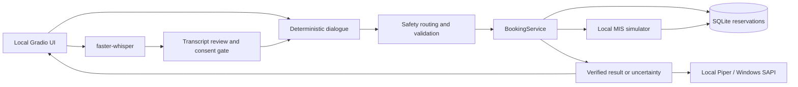

# Clinic Voice AI Assistant

A local prototype of a Russian-language clinic receptionist. It combines deterministic appointment dialogue, optional local speech recognition/synthesis, SQLite persistence and an in-process MIS simulator. It is intended for synthetic demonstrations and engineering evaluation.

## Reproducible demonstration

This service demo needs only Python 3.11+ and does not download models, import case data, open network sockets or touch the application database:

```bash
python scripts/demo_local.py
```

It actually executes separate registration consent, appointment creation, duplicate rejection, status, confirmed rescheduling with the same external ID, and confirmed cancellation. All identities and schedule rows are generated synthetic fixtures with a fixed clock. [Recorded output](docs/demo-service.json) was produced by this command; it demonstrates the service and simulator, not ASR, dialogue UI, telephony or a real MIS.

For an interactive demo, use the quickstart below and the [demo procedure](docs/demo_script.md). The [presentation](docs/presentation/clinic-voice-ai-pitch.pdf) contains the original concept and target figures, not deployment results.

## Implemented features

- A Gradio text/microphone interface with editable transcripts and manual identity/date/slot input.
- Deterministic dialogue for a small generated schedule, plus a separate case-data flow with synthetic registration, appointment status, move and cancellation.
- Confirmation before critical dialogue actions. Recognized voice agreement alone cannot authorize registration, booking, move or cancellation.
- SQLite reservations and uniqueness constraints for pending/confirmed/uncertain slots; moves reserve the target before contacting the adapter. Unknown outcomes retain locks for reconciliation.
- In-process mock REST operations, strict identity/response checks, local operator incident persistence and rule-based safety routing. Operator transfer is simulated.
- Lazy faster-whisper ASR, optional local Piper TTS on supported platforms, and Windows SAPI fallback. Text remains available after speech errors.

## Limitations

**No real MIS or telephony integration has been verified.** The UI refuses live mode. The RealMIS adapter has a mutation gate but still needs actual contract, doctor/client mapping and controlled integration tests. It must not be used as a production integration. SMS, outgoing reminders and telephone transfers are not implemented.

Use only fictional identities and authorized synthetic data. The local administrative UI has no production authentication/access-control model; it exposes local demo records. Pending/uncertain operations require human reconciliation; there is no automatic recovery procedure or blind mutation retry. Incident persistence can fall back to process memory, which is lost at shutdown.

The historical ASR comparison used 20 **Piper-generated** WAV files. Its results are not human microphone accuracy. Models/audio, original case Excel and source CSV exports are not included. Hardware speed and historical test results have not been reproduced here. Safety rules and fixture coverage do not establish clinical safety or complete language coverage.

## Architecture



`core/service.py` owns appointment mutations. `core/dialog.py` preserves the small synthetic flow; `core/clinic_dialog.py` handles the case flow. `core/schedule.py` imports schedules, `core/api_simulator.py` provides the mock API, and `core/http_client.py` is a bounded transport with no automatic redirects/retries. [Architecture details](docs/architecture.md) and [contracts](docs/contracts.md) describe these boundaries.

## Quickstart

Target Python: 3.11 or 3.12. Internet access is needed to install packages and explicitly download public speech models. CPU is the default speech device; CUDA is optional. This audit used Python 3.14.7 for the available offline checks; a complete clean installation remains unverified.

Linux/macOS:

```bash
python3.11 -m venv .venv
.venv/bin/python -m pip install -r requirements.txt
.venv/bin/python -m pip check
.venv/bin/python app.py
```

Windows PowerShell:

```powershell
py -3.11 -m venv .venv
.\.venv\Scripts\python.exe -m pip install -r requirements.txt
.\.venv\Scripts\python.exe -m pip check
.\.venv\Scripts\python.exe app.py
```

Open `http://127.0.0.1:7860`. Without a case workbook, the app creates a three-doctor synthetic schedule and demonstrates **new bookings only**. Its legacy flow does not provide case-flow registration, cancellation or move; the service demo above covers those operations independently. No credentials are required for mock mode. `start_windows.bat` installs core/UI requirements and launches text mode; `start_windows.bat --check` runs the tests, whose full requirements are listed below.

Configuration comes from process environment variables; `.env.example` documents them but `.env` files are **not loaded automatically**. Set variables in the shell (`export NAME=value` in Bash, `$env:NAME="value"` in PowerShell). Keep `MIS_MODE=mock`. ASR defaults to cached models only; `ASR_LOCAL_ONLY=1` prevents implicit model downloads.

Optional speech (use the virtual-environment Python executable):

```bash
python -m pip install -r requirements-voice.txt -r requirements-tts.txt
python scripts/download_asr_small.py
python -m piper.download_voices ru_RU-irina-medium --data-dir data/models
python app.py
```

`ASR_DEVICE=cpu` uses int8. `TTS_ENGINE=piper` selects the downloaded local voice; `auto` tries Piper and then SAPI on Windows; `DISABLE_TTS=1` disables speech output. Model and voice downloads, microphone capture, audibility and real ASR remain unverified in the current restricted environment. Review upstream model/voice terms before redistribution.

### Optional case workbook

Only use an authorized synthetic copy. Place exactly one workbook in `data/source/` with the seven sheets described in [contracts](docs/contracts.md), then run:

```bash
python scripts/import_clinic.py
python app.py
```

The importer uses a separate `data/clinic_demo.sqlite3`, stores source hash/provenance and rejects replacing populated data with a different workbook. Availability uses GMT+4, a 14-calendar-day horizon including today, same-day 30-minute lead time, working calendar and absence rules. It never invents expired slots. The original case workbook is absent; historical doctor/slot counts are not reproduced audit results. See [API notes](docs/api-notes.md) for mock boundaries.

## Verification

```bash
python -m pip install -r requirements.txt -r requirements-voice.txt -r requirements-dev.txt
python -m pip check
python -m unittest discover -s tests -v
python scripts/demo_local.py
python scripts/smoke_local.py
python -m ruff check .
python scripts/check_format.py
python -m bandit -r core app.py -lll
python -m pip_audit --progress-spinner off
```

ASR preprocessing tests need NumPy, PyAV and faster-whisper from the voice dependency group; model-backed tests skip without local models. Case integration tests need the authorized workbook/imported DB. HTTP tests need loopback sockets. Tests are not disabled to accommodate the audit environment.

**Current full discovery: 50 passed, 0 assertion failures, 11 errors, 13 skips.** The errors are missing dependencies/imports and a denied socket, so this is not a successful full-suite result. The original claim of 123 passing tests has not been reproduced. Details, baseline comparison and exact dependency availability: [verification](docs/verification.md), [machine-readable result](docs/verification-results.json).

CI is configured for Windows/Linux Python 3.11/3.12, with separate dependency/security checks. YAML is locally parsed; remote jobs, Ruff, Bandit and dependency advisories have not run here. No passing CI badge or vulnerability-free claim is made.

## Design decisions

Appointment actions follow a deterministic controller rather than unconstrained LLM tool calls. Structured fields are checked against actual local slots, a fresh summary requires explicit consent, and service mutations enforce ownership and reservation rules. This makes refusals, timeouts and conflicts reproducible in tests.

The tradeoff is limited language coverage and more clarification turns. `core/understanding.py` supports an optional validated, loopback-only Ollama parser; it cannot execute mutations and falls back to deterministic extraction on errors. Actual LLM inference has not been validated. Alternatives include a larger intent parser or LLM-assisted field extraction, while retaining the same service/consent boundary. Giving an LLM direct scheduling authority would require a different safety and evaluation model.

SQLite `BEGIN IMMEDIATE` and partial unique indexes coordinate writers using the same database file. They do not prevent independent real-MIS clients from booking a slot. The HTTP budget is process-local, shared across reads/writes; a timeout does not prove a mutation failed. Unknown create/cancel/move outcomes remain blocked rather than being retried automatically.

## Documentation and provenance

- [Reproducible demo procedure](docs/demo_script.md)
- [Verification and remaining blockers](docs/verification.md)
- [Contracts](docs/contracts.md) · [Architecture](docs/architecture.md) · [API notes](docs/api-notes.md)
- [Synthetic ASR results](docs/asr-results.md) · [Voice quality](docs/voice-quality.md)
- [Historical AI-assisted development records](docs/provenance/README.md)

The development missions and original author-supplied evidence are retained. AI involvement and existing Git history have not been removed. No project license is present; the owner must choose/confirm licensing before treating this as a reusable public distribution. Dependencies, models, voices and case material have separate terms.
