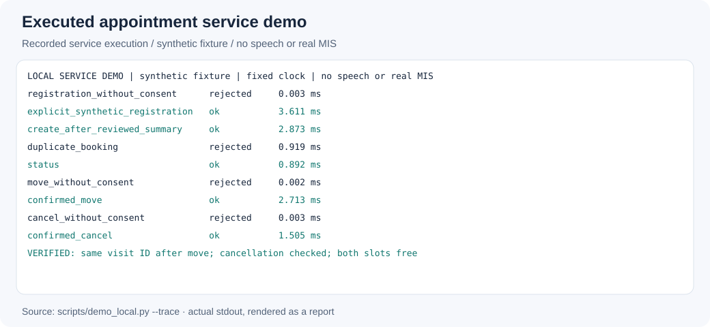
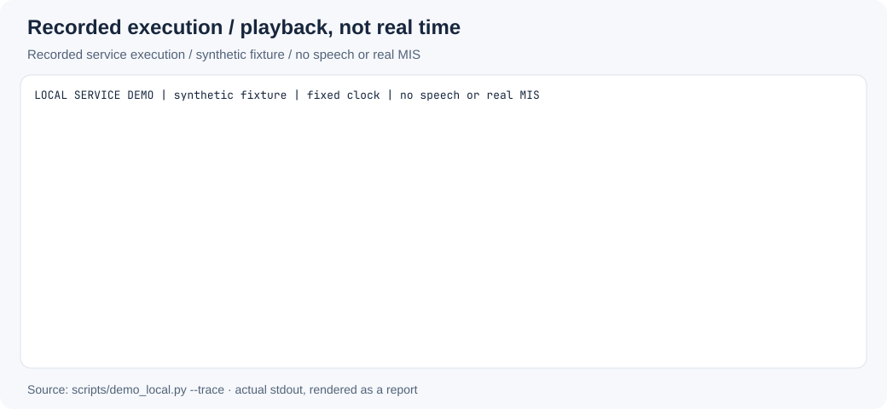
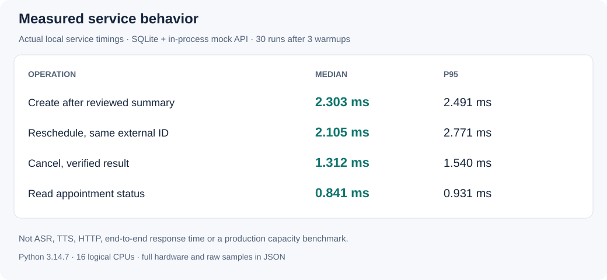
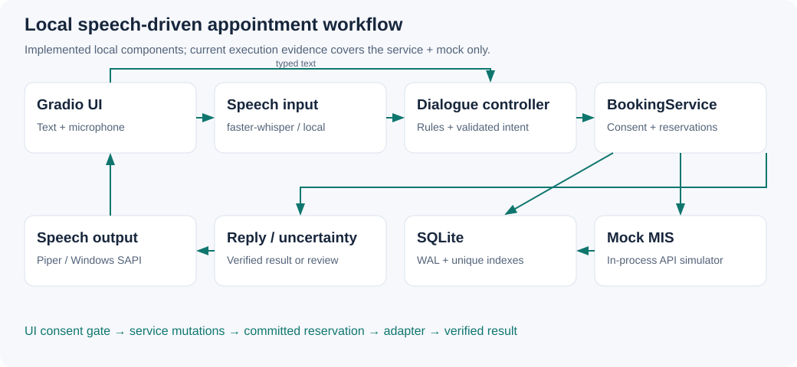

# Clinic Voice AI Assistant

A local speech-driven appointment workflow prototype: deterministic dialogue, explicit consent, SQLite reservations and a simulated MIS. Built for synthetic demonstrations, not production patient handling.

## Executed demonstration



*Actual registration → booking → status → move → cancellation against the in-process simulator, including refused unconfirmed operations and duplicate rejection. Generated synthetic fixture; no real patient data or speech session.*

```bash
python scripts/demo_local.py --trace
```

<details>
<summary>Recorded CLI execution replay — 11 seconds, not real-time UI or speech</summary>



One recorded line is revealed per second. Playback speed is editorial, not measured execution speed. [Captured stdout, sources and regeneration](docs/assets/README.md).

</details>

## Measured service behavior



30 sequential repetitions after 3 warmups on AMD Ryzen 7 7735H, 16 logical CPUs, Linux, Python 3.14.7. Create/move/cancel medians: **2.303 / 2.105 / 1.312 ms**. Measurements include the timed service's SQLite and in-process MIS work; exclude fixture construction, speech and HTTP. This is not end-to-end response latency or a production capacity result. [Raw samples and hardware](docs/assets/service-benchmark.json).

```bash
python scripts/benchmark_service.py --repeats 30 --warmup 3 --output docs/assets/service-benchmark.json
```

The old 123-PASS and synthetic ASR figures are historical author-supplied records. [Current verification](docs/verification.md) records actual counts and resource errors; no human ASR accuracy or live integration is inferred from them.

## Architecture and state



- Deterministic dialogue and Pydantic-validated intent keep model output outside mutation authority. Recognized YES alone cannot authorize critical actions.
- `BEGIN IMMEDIATE`, pending reservations and partial unique indexes protect concurrent local writers. Unknown outcomes retain locks; timeout does not justify retrying a mutation.
- Rescheduling preserves the external visit ID. A cancel/move response naming a different visit stays uncertain.
- Operator/safety routing responds before asynchronous incident persistence. The handoff is simulated, not a phone transfer.

[Booking/move/cancel sequence diagrams, actual dialogue states, transaction boundaries and recovery tradeoffs](docs/workflows.md) · [Detailed contracts](docs/contracts.md).

## Quickstart

Target Python 3.11/3.12. Core text mode needs no speech model; first installation needs network access.

```bash
# Linux/macOS
python3.11 -m venv .venv
.venv/bin/python -m pip install -r requirements.txt
.venv/bin/python app.py
```

```powershell
# Windows PowerShell
py -3.11 -m venv .venv
.\.venv\Scripts\python.exe -m pip install -r requirements.txt
.\.venv\Scripts\python.exe app.py
```

Open `http://127.0.0.1:7860`. Without a case workbook, the UI uses a three-doctor synthetic **new-booking-only** flow. The executed service demo above covers move/cancel independently; the full case dialogue needs an authorized synthetic workbook. [Interactive and voice setup](docs/quickstart.md).

## Scope and limitations

The Gradio text/microphone interface, editable transcript, manual fields, local ASR/TTS adapters and appointment controller are implemented. An actual browser/speech demonstration remains **BLOCKED** here by missing dependencies/models and denied sockets. The visual replay above is the executed service, not an invented Gradio recording.

Real MIS/telephony, SMS and outgoing reminders are unintegrated. UI live mode remains disabled. The local administrative panel is not an authenticated production console. Uncertain operations require human reconciliation; no automated recovery engine is claimed. Use only fictional identities and permitted synthetic case files. No medical advice or real operator connection is provided.

Historical ASR comparisons used 20 Piper-generated WAVs, not human microphone recordings. [Original synthetic evaluation](docs/asr-results.md) · [Voice limitations](docs/voice-quality.md).

## Verification and reproduction

```bash
python -m pip install -r requirements.txt -r requirements-voice.txt -r requirements-dev.txt
python -m unittest discover -s tests -v
python scripts/demo_local.py
python scripts/smoke_local.py
python scripts/check_assets.py
python scripts/check_format.py
```

The service demo and new SQLite regressions run without third-party packages. Full discovery is not green in the current environment; dependencies, loopback sockets and some original fixtures are unavailable. Windows/Linux CI includes tests, safe asset checks, syntax/lint, HTTP smoke and dependency/security checks. Remote execution is pending. [Machine-readable results](docs/verification-results.json) · [Actual counts and publication blockers](docs/verification.md).

[Visual provenance](docs/assets/README.md) · [Demo procedure](docs/demo_script.md) · [Historical AI-assisted development records](docs/provenance/README.md). Existing authorship and history are preserved. Project, case-derived presentation and model/voice redistribution terms still require review.
