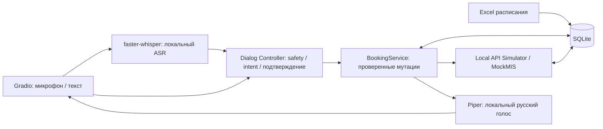

# Clinic Voice AI Assistant — голосовая регистратура

**Локальный MVP с реальными исходными данными кейса клиники и адаптером под REST API стенда; интеграционный тест живого стенда ожидает доступа.**

Операции выполняются только в локальном **MOCK**, не в МИС организаторов. Excel
сам обозначает графики/статусы как подготовленные для хакатона. Используйте исключительно вымышленных пациентов.

## Что работает

Обновление голоса и свободных фраз: [ручная проверка и результаты](docs/voice-quality.md).
Микрофон теперь отвечает после остановки записи; исправляемый текст остаётся на экране,
критические действия отдельно подтверждаются. **ASR Benchmark** внизу записывает 20 ваших фраз
и сравнивает base/small по одинаковым аудио: WER/CER, важные поля и задержка. Ваш голос пока не измерен.

- Импорт предоставленного Excel: **85 врачей, 136 973 слота**, все семь листов сохранены в локальной модели/происхождении данных.
- Доступность только «Свободен», с проверкой календаря/отсутствий, будущего времени, горизонта 14 дней и запаса 30 минут сегодня.
- Поиск врача/специальности, страницы по 10 врачей, кабинет и фактическая длительность из Excel.
- Идентификация синтетического пациента; **запись, статус, перенос и отмена** с подтверждением, защитой от дублей и неопределённых результатов.
- Если карточки нет, помощник предлагает создать вымышленную карточку прямо в разговоре. Регистрация требует отдельного согласия; контекст записи сохраняется. Отдельная форма остаётся альтернативой.
- Локальный Piper TTS: реальный русский WAV; ручная кнопка воспроизведения и диагностика. SAPI остаётся резервным вариантом.
- Редактируемый ASR-транскрипт; локальные профили small/base, CPU int8. Неуверенное/пустое распознавание требует проверки. Диагностика вынесена в панель разработчика; ручные поля и выбор свободного времени сохранены.
- Свободные фразы с несколькими параметрами, исправление даты/времени, «после трёх», «второй вариант», кабинет/стоимость без сброса разговора. Локальная LLM по умолчанию выключена.
- Правила РГ-ТЕЛ-01: экстренная ветка 103/112, оператор, жалобы, FAQ, отсутствие медицинских советов и реального перевода.
- Очередь оператору в административном разделе: причина, P1/P2/P3, контекст, статус «Требуется оператор». Анонимные обращения сохраняются локально без выдуманного client_id.
- Swagger-совместимый симулятор: Bearer, /api/v1, пагинация ≤50, клиенты/визиты/эскалации, PATCH переноса/отмены, изоляция команд.

## Запуск на Windows

Публичный репозиторий содержит код, синтетические тестовые фразы и обезличенные агрегаты.
**Исходные Excel/CSV, базы, записи голоса, модели и секреты в Git не входят.**
Python 3.11+ и Git должны быть установлены. Для нового клона:

```powershell
git clone https://github.com/H-G11/clinic-voice-ai-assistant.git
cd clinic-voice-ai-assistant
py -3 -m venv .venv
.\.venv\Scripts\python.exe -m pip install -r requirements.txt -r requirements-voice.txt -r requirements-tts.txt
# Разрешённая явная загрузка публичных ASR-моделей (аудио никуда не отправляется):
.\.venv\Scripts\python.exe scripts/download_asr_small.py
.\.venv\Scripts\python.exe -c "from huggingface_hub import snapshot_download; snapshot_download('Systran/faster-whisper-base', token=False)"
# Русский голос Piper, только локальный синтез:
.\.venv\Scripts\python.exe -m piper.download_voices ru_RU-irina-medium --data-dir data/models
```

`requirements.txt`: Gradio и openpyxl; `requirements-voice.txt`: faster-whisper/PyAV;
`requirements-tts.txt`: Piper. Pydantic/numpy входят в зависимости Gradio.
Исторические агрегаты уже включены; построение PNG использует Pillow из зависимостей Gradio.
Не устанавливайте CUDA для первого запуска: по умолчанию CPU int8.

### Расписание для полного DEMO

Получите разрешённый Excel **у организаторов хакатона/владельца кейса**; публичной ссылки
на исходные пользовательские файлы проект не предоставляет. Файл не следует прикладывать к GitHub issue или коммиту.
Создайте `data/source/` и поместите туда единственный исходный
`Расписание_врачей_25.06-31.12.2026.xlsx`, содержащий листы Описание, Специальности,
Врачи, Слоты, Недоступность, Календарь, График. Затем:

```powershell
New-Item -ItemType Directory -Force data/source
# Скопируйте разрешённый Excel в data/source через Проводник.
.\.venv\Scripts\python.exe scripts/import_clinic.py
# Ожидается 85 врачей и 136973 слота. Импорт использует отдельную clinic_demo.sqlite3.
```

CSV/регламент/Swagger не требуются для обычного запуска: их разрешённые правила и
локальный API-симулятор уже реализованы в коде. Сырые CSV нужны только для повторной аналитики;
их также получают отдельно у организаторов и хранят в `data/source/`.
Без Excel приложение создаёт **старый ограниченный синтетический пример** с тремя врачами:
это не полное DEMO с 85 врачами и не замена входного расписания. Case-тесты без импортированной базы пропускаются.
Для полного сценария записи/переноса/отмены сначала импортируйте разрешённый Excel.
Проверка расписания использует текущую дату GMT+4; после окончания исходного периода нужны новые согласованные данные.

```powershell
.\start_windows.bat
# Тесты без открытия браузера:
.\start_windows.bat --check
# Повторяемые проверки:
.\.venv\Scripts\python.exe -m unittest discover -s tests -v
.\.venv\Scripts\python.exe scripts/import_clinic.py
.\.venv\Scripts\python.exe scripts/check_voice.py
.\.venv\Scripts\python.exe scripts/check_ui_e2e.py
```

UI: `http://127.0.0.1:7860`, без публичного sharing. Python 3.11+; проверено на 3.14.6.
Если приложение уже запущено, остановите прежний процесс **Ctrl+C в его окне** и снова выполните `start_windows.bat`: обновление файлов само не перезапускает сервер.
`start_windows.bat` использует существующую .venv, при первом запуске устанавливает базовые зависимости.
Для чистого окружения: `install_voice_windows.bat` для ASR; `install_tts_windows.bat`
для Piper и одного русского голоса. Эти установщики загружают код/модель, но не отправляют аудио или пациентов.
Во время диалога TTS модели не скачивает. Никаких LLM, GPU-драйверов или облачного распознавания.

Полный прогон с расписанием и локальным голосом: **123 теста** в проверенной сборке.
Без закрытого Excel или установленной модели часть интеграционных проверок явно отмечается SKIP;
это не подтверждение полного голосового DEMO. Проверяются даты/время, идентификация, явное согласие,
дубли/конкурентность/таймауты, запись → статус → перенос → отмена, safety, ASR и benchmark, Piper.
HTTP-проверка интерфейса: `scripts/check_ui_e2e.py` после импорта Excel и установки голосовых моделей;
этот дополнительный прогон использует локальный синтетический аудиокорпус, создаваемый
`scripts/asr_benchmark.py --generate`. Основная база в тестах не очищается.

## Архитектура



LLM, если явно включена, только предлагает валидируемые параметры. Доступность,
идентификация и мутации принадлежат сервису/SQL. Настоящий API организаторов **не подключён**.

Файлы кейса скопированы в игнорируемую `data/source/`. Новый импорт — `data/clinic_demo.sqlite3`;
прежняя `data/demo.sqlite3` с бронями сохранена. Повтор того же Excel — no-op по SHA256;
замена расписания в непустой базе запрещена до отдельной сверки. Продукт берёт текущие время/дату **GMT+4**,
не «сегодня» из Описание!B5. Фактические слоты заканчиваются 30.12.2026, отсутствующее 31 декабря не генерируется.

## Сквозное демо

1. Напишите «Запишите к хирургу» → вымышленные «Тестов Иван Сергеевич» → «01.01.1990».
2. Если карточки нет, проверьте ФИО/дату и нажмите «Да, создать вымышленную карточку» либо введите «да» вручную.
   Помощник продолжит тот же разговор. Если карточка уже существует, повторная регистрация не нужна.
3. Выберите врача → предложенную дату → свободное время. Проверьте сводку с кабинетом и отдельно подтвердите запись кнопкой или текстовым «да».
   Распознанное голосовое «да» само не выполняет критическую операцию.
4. Обновите таблицу: видны локальная бронь и ID симулятора. Занятое время исчезает из выбора.
5. «Перенести запись» → те же ФИО/дата рождения → новые дата/время → подтверждение. ID визита симулятора сохраняется.
6. «Отменить запись» → идентификация → «отменить» в предложении переноса → подтверждение.
   «Статус записи» → идентификация: после отмены показывается «Отменена».
7. «Оператор» / «хочу пожаловаться» → раскройте административный раздел внизу и обновите очередь.
   «Давит в груди» → немедленная инструкция 103/112. Телефонного соединения нет.
8. «Проверить голос» → ▶. Piper слышен по вашему ручному тесту; автоматический HTTP-прогон проверяет доставку PCM.

Участки, прикрепление, направления не содержатся в Excel. Их проверка **не выдумывается**:
к участковому/по направлению — сотрудник; для общего локального примера используйте хирурга.
Подтверждение прикрепления даже в прямом демо неполное и не является допуском к реальной помощи.
FAQ использует условные сведения РГ-ТЕЛ-01; актуальные цены/адрес/режим необходимо подтвердить перед реальным использованием.

## Настройки и данные

`.env.example` — справочник; `.env` автоматически не загружается. Пример PowerShell:

```powershell
$env:ASR_DEVICE='cpu'
$env:ASR_BEAM_SIZE='5'
$env:ASR_VAD='0'
$env:ASR_LOCAL_ONLY='1'  # только при заполненном кэше
$env:TTS_ENGINE='auto'  # piper / sapi
$env:DISABLE_TTS='0'
```

Входное аудио после ASR удаляется из локального cache проекта; исходники/базы/аудио/модели/логи исключены из Git.
`data/metrics.jsonl` содержит только тайминги, движок и успешность, без текста и пациентов.
По умолчанию UI использует уже скачанную `data/asr_models/small`, beam=5, VAD выключен; профиль «Быстрее» — base.
Если small отсутствует, используется кэшированная base. В диалоге загрузок моделей из сети нет.
`ASR_MODEL`, если задана, переопределяет профиль; уберите старую переменную с `base`, чтобы сравнить профили.
На 20 **синтетических Piper-аудио** исходная base: 13/20 нужных полей, медиана 0,87 с; small: 17/20, 2,98 с.
Это проверка аудио → ASR → извлечение поля; точность человеческой речи/вашего микрофона пока не измерена.
Полные параметры, WER, задержки и процедура ручной проверки — [результаты ASR](docs/asr-results.md).

## API и аналитика

```powershell
# Необязательный локальный HTTP-симулятор, только loopback:
.\.venv\Scripts\python.exe scripts/serve_mock_api.py
# Исторические агрегаты без телефонов и хэшей пациентов:
.\.venv\Scripts\python.exe data/analysis/report.py
```

Симулятор: `127.0.0.1:8765/api/v1`, открытый fixture-токен `local-demo-token` (не токен организаторов).
API намеренно разрешает двойные слоты, как описано в Swagger; SQL-защита живёт в сервисе.
HTTP-клиент ограничен 8 запросами/мин суммарно в одном процессе, без автоматических повторов POST/PATCH.
RealMIS реализован по текстовой документации, проверен на фиктивном транспорте; запуск LIVE в UI остаётся закрыт
до URL/токена, проверки соответствий ID и явного разрешения. Чужие командные брони API не показывает.

CSV: 17 772 звонка, 3 687 пропущенных; 35 470 приёмов, 4 079 неявок.
Это историческая база, **не KPI внедрения**. Графики/выводы — [insights](docs/insights.md), [экономика с допущениями](docs/economics.md).

Материалы: [прогресс](docs/progress.md), [приёмка](tests/acceptance.md), [контракты](docs/contracts.md),
[API](docs/api-notes.md), [архитектура](docs/architecture.md), [демо](docs/demo_script.md),
[сквозной HTTP-протокол](docs/ui-evidence.json), [описание для сдачи](docs/checkpoint_submission.md).
Резервные копии — локальная игнорируемая `backups/`. Телефония, SMS и напоминания не реализованы.
Для жюри владелец готовит видео/доступную ссылку: localhost извне недоступен.
