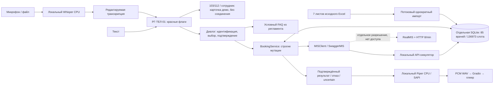

# Локальная архитектура кейса

Исходники кейса — игнорируемая data/source/. Индексированное расписание и локальные
синтетические клиенты/визиты/эскалации — data/clinic_demo.sqlite3. Старая demo.sqlite3
сохраняется. В API-симуляторе нет ограничения двойного слота: оно и ограничения
одной специальности реализованы атомарно в BookingService/SQL.

Календарь сервиса GMT+4, реальное текущее время; B5 Excel только происхождение данных.
14 календарных дней включают сегодня; сегодня не менее 30 минут с округлением вверх.
Исходные статусы/кабинеты/длительности не синтезируются. Недоступность/выходные запрещают слот.

При переносе удерживаются исходный и новый слоты, используется PATCH того же visit ID.
Таймаут → uncertain, без повторной мутации. Никакой автоматической сверки с недоступным стендом.
Живые и мок-ID не смешиваются; сопоставление врачей по ФИО+специальности, неоднозначности — вручную.

Входное аудио удаляется после ASR из локального cache проекта, выходные WAV локальны.
Метрики сохраняют только длительность/движок/успех. История диалога — память сессии.
Синтетические карточки передачи сохраняют ограниченный снимок собранных полей в operator_incidents;
при сбое записи инцидент виден только в памяти текущего процесса. Фоновое сохранение/поиск
проверенного client_id не задерживает экстренную инструкцию. Очередь показана в административном разделе,
реального телефонного соединения нет. Создание отсутствующего MOCK-клиента требует отдельного согласия в разговоре.
CSV-анализ экспортирует агрегаты и PNG, не телефоны/хэши пациентов. Внешних облачных ИИ нет.
Лимитер одного процесса: для нескольких процессов до LIVE нужен общий межпроцессный механизм.
