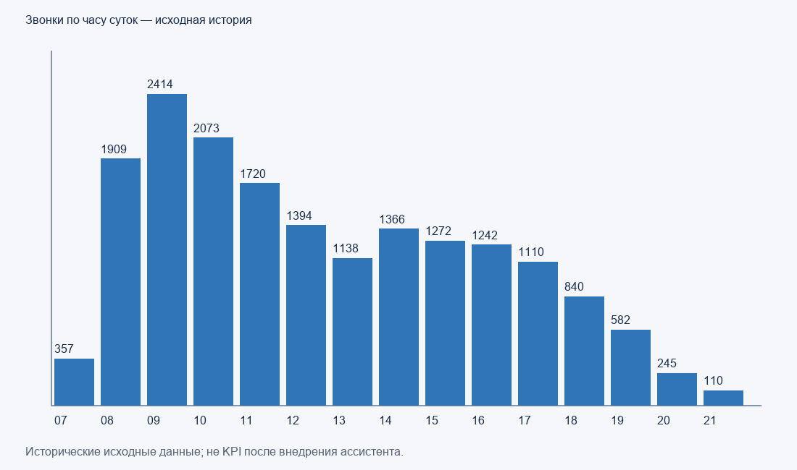
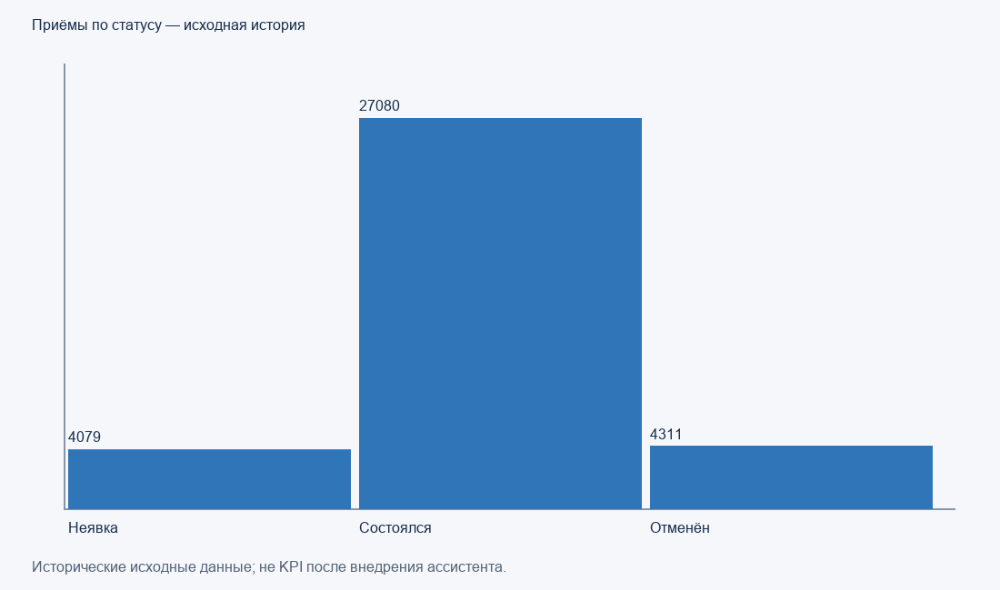

# Исторические наблюдения

Источник: два предоставленных CSV, локальный расчёт. Не результаты внедрения бота.

Звонки: 17772; пропущено 3687 (20.75%). Пик 09:00: 2414.
Период звонков: 2026-06-01T07:05:01 — 2026-08-31T21:14:16.

Часовые доли в 07:00 и с 20:00 показаны без исключений. Они могут отражать отсутствие операторов;
без журнала смен/праздников причинность не установлена. Часы регламента условные.

| Час | Звонки | Пропущено | Доля |
|---|---:|---:|---:|
| 07:00 | 357 | 357 | 100.0% |
| 08:00 | 1909 | 405 | 21.2% |
| 09:00 | 2414 | 551 | 22.8% |
| 10:00 | 2073 | 447 | 21.6% |
| 11:00 | 1720 | 196 | 11.4% |
| 12:00 | 1394 | 168 | 12.1% |
| 13:00 | 1138 | 137 | 12.0% |
| 14:00 | 1366 | 165 | 12.1% |
| 15:00 | 1272 | 219 | 17.2% |
| 16:00 | 1242 | 240 | 19.3% |
| 17:00 | 1110 | 200 | 18.0% |
| 18:00 | 840 | 152 | 18.1% |
| 19:00 | 582 | 95 | 16.3% |
| 20:00 | 245 | 245 | 100.0% |
| 21:00 | 110 | 110 | 100.0% |

Приёмы: 35470; статусы: {"Неявка": 4079, "Состоялся": 27080, "Отменён": 4311}.
Неявки среди всех записей: 11.50%; среди Состоялся + Неявка: 13.09%.
Отмены исключены только из второго знаменателя. Период: 2026-03-25 — 2026-09-24.

| Специальность | Записи | Неявка | Доля среди состоялся+неявка |
|---|---:|---:|---:|
| Акушер-гинеколог | 2680 | 234 | 9.90% |
| Гастроэнтеролог | 642 | 86 | 15.14% |
| Дерматовенеролог | 1712 | 281 | 18.86% |
| Кардиолог | 1752 | 140 | 8.86% |
| Невролог | 1854 | 248 | 14.98% |
| Оториноларинголог | 4119 | 617 | 17.25% |
| Офтальмолог | 3719 | 428 | 12.92% |
| Педиатр | 5895 | 550 | 11.02% |
| Терапевт | 8701 | 975 | 12.70% |
| Травматолог-ортопед | 1882 | 241 | 14.30% |
| Уролог | 713 | 99 | 15.47% |
| Хирург | 604 | 74 | 13.78% |
| Эндокринолог | 1197 | 106 | 9.77% |

