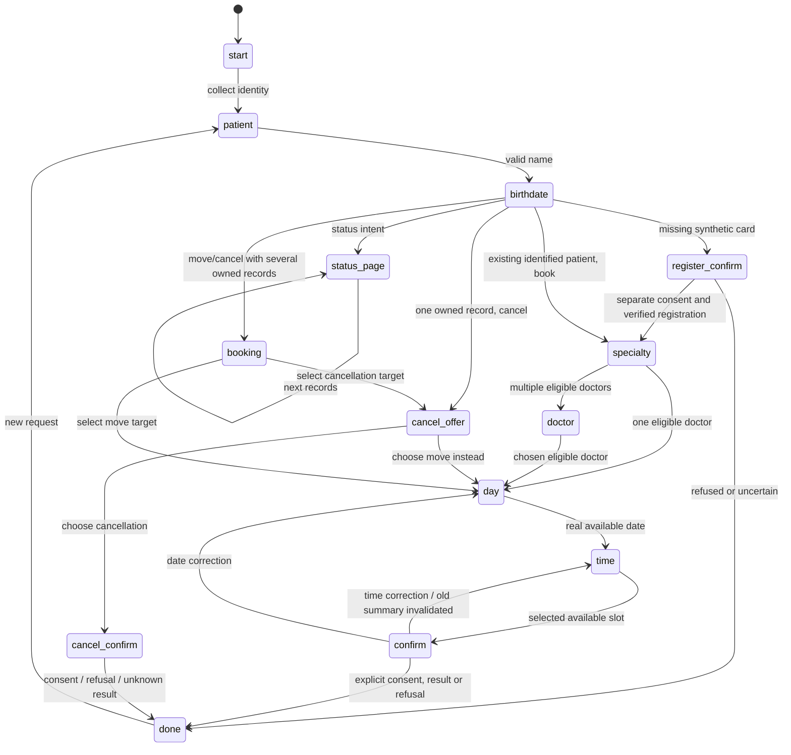

# Workflow mechanics and failure boundaries

The UI and speech pipeline are optional adapters around deterministic dialogue and `BookingService`. ASR supplies a candidate transcript, never scheduling authority. Pydantic validates the meaning schema; consent and slot/identity checks remain outside the model. The optional loopback LLM is not exercised in this showcase.

## Booking and confirmation

```mermaid
sequenceDiagram
    participant U as Synthetic user
    participant D as UI / dialogue
    participant S as BookingService
    participant DB as SQLite
    participant M as Mock MIS
    U->>D: Identity, doctor and available slot
    D-->>U: Fresh summary; explicit confirmation required
    U->>D: Manual confirmation
    D->>S: create(patient, birthdate, doctor, slot)
    S->>DB: BEGIN IMMEDIATE; validate slot; insert pending; COMMIT
    S->>M: create once
    alt Validated success with external ID
        M-->>S: ok + ID
        S->>DB: confirmed + external ID
        S-->>D: Verified result
    else Timeout or malformed response
        S->>DB: uncertain / retain pending lock on persistence failure
        S-->>D: Reconciliation required; no automatic retry
    end
```

`create` assumes the caller obtained consent; `dialog.reply` and the UI own that consent gate. The service separately validates identity, available slot and policy. Cancellation/rescheduling expose an additional explicit `confirmed` argument. Speech-recognized YES alone cannot pass the UI gate. These are layered local controls, not production authentication.

## Rescheduling

```mermaid
sequenceDiagram
    participant U as Synthetic user
    participant S as BookingService
    participant DB as SQLite
    participant M as Mock MIS
    U->>S: Confirm move of owned future booking
    S->>DB: BEGIN IMMEDIATE; old pending; target pending operation=move; COMMIT
    S->>M: PATCH same external visit ID once
    alt Same ID, validated success
        S->>DB: Old rescheduled; target confirmed, operation=create
    else Definite rejection
        S->>DB: Old confirmed; target failed
    else Timeout, wrong ID or unknown result
        S->>DB: Both uncertain; retain both slot locks
    end
```

The extra move row avoids losing the original reservation before an external outcome is known. `uq_blocked_slot` protects doctor/time; `uq_patient_specialty` prevents another active create operation for the patient/specialty while the move is pending. Locks coordinate writers using one SQLite file; they do not coordinate independent databases or other real-MIS clients.

## Cancellation and recovery

```mermaid
sequenceDiagram
    participant U as Synthetic user
    participant S as BookingService
    participant DB as SQLite
    participant M as Mock MIS
    U->>S: Explicitly confirm cancellation
    S->>DB: Verify ownership/future/confirmed; commit pending
    S->>M: PATCH status once
    alt Same-ID verified success
        S->>DB: cancelled; release local slot
    else Definite rejection
        S->>DB: confirmed; preserve original slot
    else Timeout, wrong ID or malformed outcome
        S->>DB: uncertain; preserve lock
        S-->>U: Human reconciliation required
    end
```

There is no automated reconciliation engine. The status operation checks actual adapter response identity/doctor/time/status but does not automatically unlock uncertain rows. A repeat mutation against pending/uncertain records is rejected. Process crashes can leave pending reservations; the design chooses review over possible duplicate mutation.

## Actual case-dialogue states



This diagram summarizes case flow in `core/clinic_dialog.py`, not the smaller legacy new-booking-only dialogue. A unique known target can skip `booking`; stored specialty/date preferences can skip other collection states. Safety/operator routing globally interrupts and resets to a fresh state with a handoff card. Three failed clarifications form a simulated handoff. Explicit booking refusal stops the draft; a call-recording request never pretends a nonexistent recording switch worked.

## Data and privacy boundaries

SQLite stores synthetic patients/bookings and incident snapshots. `queue_handoff` immediately returns a process-local card; its worker persists the card and optionally posts to the local simulator only for an identified mock patient. Failure can leave memory-only state, lost on shutdown. The safety instruction does not wait for DB/API latency.

Gradio is loopback-only with no public share link; the local administrative panel is not a secured production console. Audio cleanup is scoped to the application's cache. Benchmark recording is explicit and local. No real patient, private workbook or medical interaction is included in generated showcase assets.

## Measured scope

[service-benchmark.json](assets/service-benchmark.json) measures real sequential service calls with temporary SQLite databases and in-process MIS, using 30 repetitions after 3 warmups. Fixture construction and identity/status reads outside the individual timed call are excluded. This is not HTTP latency, ASR/TTS latency or capacity under load. Raw samples and hardware are retained; numbers may change between machines and filesystems.

Actual speech and browser sessions remain blocked by missing packages/models and denied sockets. The SVG/GIF is a rendering/replay of captured CLI stdout, not an invented Gradio screenshot. The replay reveals recorded lines at one line/second; it does not reproduce execution timing.
